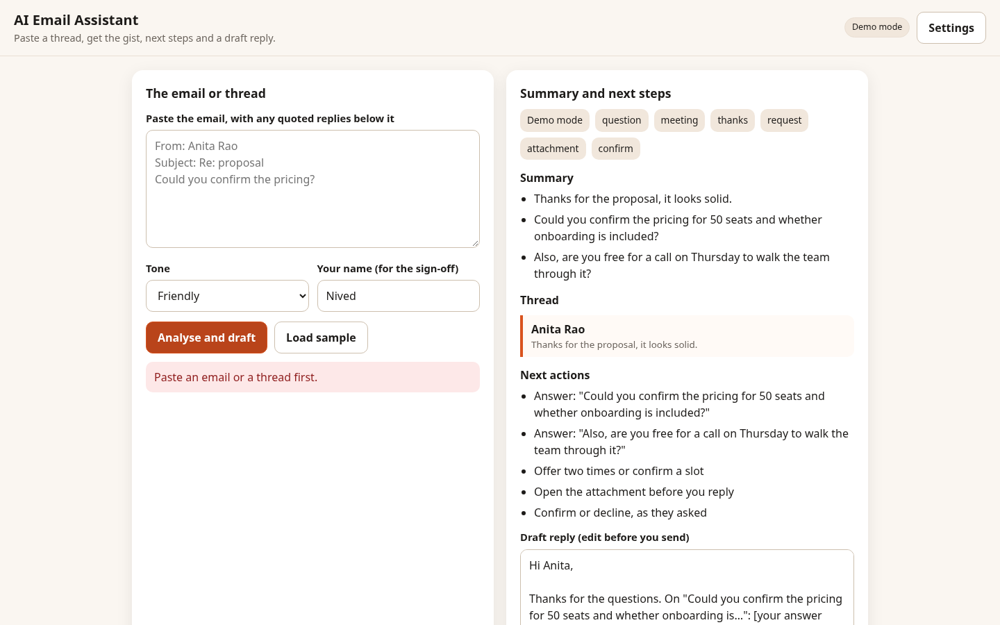

# AI Email Assistant

Paste a thread, get the gist, next steps and a draft reply.



## What it does
Paste an email or a whole thread and the assistant summarises it, shows who said what, and picks out questions, meeting requests, deadlines and attachments. It suggests concrete next actions and writes an editable draft reply in a friendly, formal or short tone, signed with your name. Quoted replies are ignored. Demo mode is offline and rule-based; live mode uses your own OpenAI-compatible model.

## Features
- Thread parsing that drops quoted replies
- Summary, per-message lines and participants
- Question, meeting, deadline and attachment detection
- Next-action suggestions
- Draft reply in friendly, formal or short tone

## Quick start
Open `index.html` directly, or serve the folder:

```bash
python3 -m http.server 8000
# then open http://localhost:8000
```

## Demo mode and live mode
- **Demo mode (default):** fully offline and deterministic. Every feature works with no key.
- **Live mode:** click **Settings**, choose *Live*, and enter an OpenAI-compatible base URL, API key and model. Your key is kept only in this browser's localStorage. It is never committed and never sent anywhere except the endpoint you enter.

Code layout: `src/core/` is pure logic with no DOM. `src/ui/` and `src/app.js` are the browser UI.

## Tests
```bash
npm test                      # node --test unit tests (67 tests)
pip install playwright && playwright install chromium
python3 tests/e2e/e2e.py      # Playwright smoke at 390x844 and 1440x900, demo + mocked live
```
The e2e script checks: no console errors, no horizontal scroll, demo mode makes no network calls, live mode uses a mocked endpoint.

## Limitations
Rule-based in demo mode: it finds patterns, it does not understand the email. Always read the draft before sending.

## Licence and credit
MIT licence, Copyright (c) 2026 Nived NS. See LICENSE.

Created and owned by Nived NS - https://github.com/connectnived-lab
